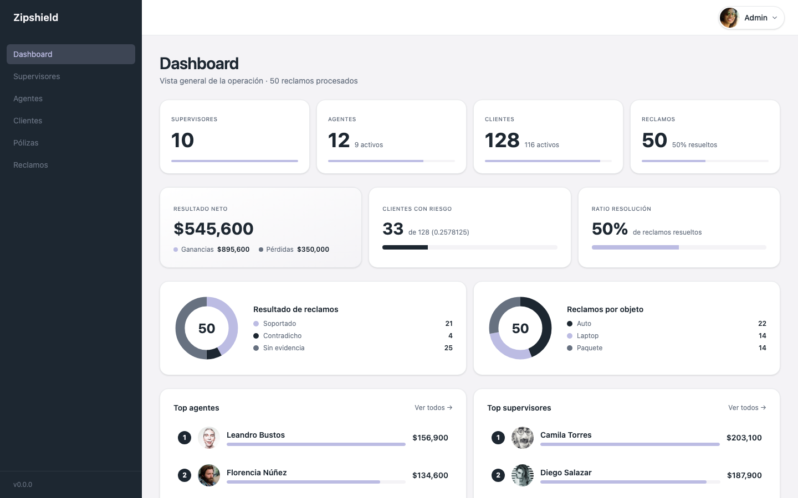
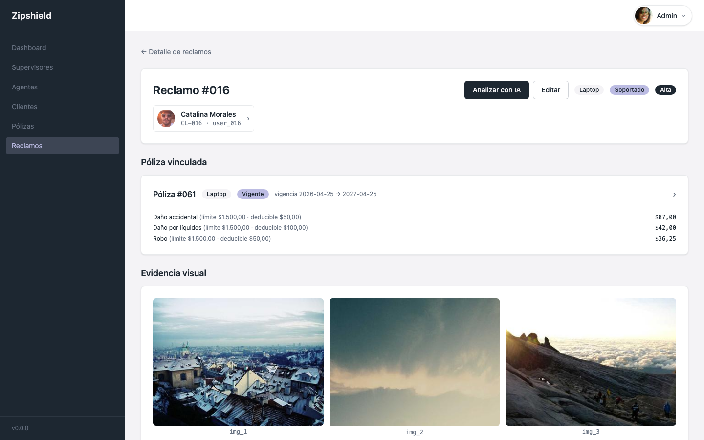
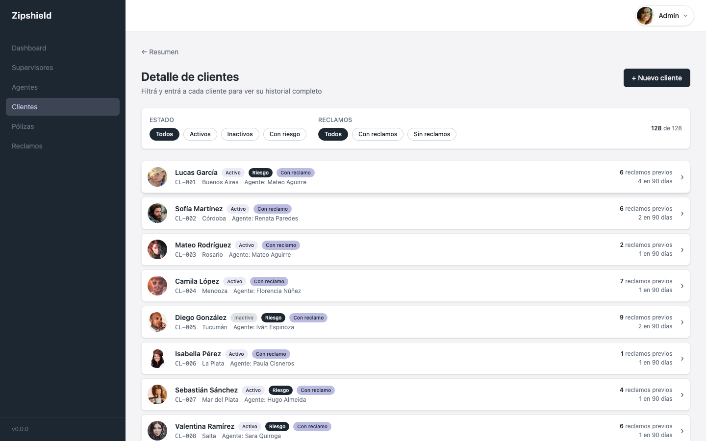

# Zipshield

An insurance claims platform with automatic AI review and role based access control enforced on the server, not just hidden in the UI.

A FastAPI backend and an Angular 22 frontend that model the actual workflow of an insurance company. Agents onboard clients and policies, clients file claims, and a vision model reviews the photo evidence on each claim before a human has to look at it.



## What it does

**Claims**
- Claims are filed against a policy that must be in force on the date of loss.
- An AI model (via OpenRouter) reviews the attached photos against the minimum evidence requirements for the object type, checks the client's claim history and the actual coverage on their policy, and returns a verdict with a written justification. It never approves a claim without evidence.
- A prompt injection guard keeps the claimant's text from being read as instructions to the model. It can only describe the incident, never direct the review.
- Client claim history is computed live from real claims, so it never drifts out of sync with the data.

**Policies**
- Quoting and issuing with an auditable premium breakdown: net premium, taxes and fees, and total premium, itemized by coverage.
- A coverage catalog per product type (car, laptop, package), each with its own rate, deductible and limit.
- A full status lifecycle (quote, underwriting, in force, expired, cancelled, renewed) with an immutable event history.
- Automatic expiration. A lapsed policy stops counting as active without anyone having to update it by hand.
- Premiums are computed with Decimal arithmetic from start to finish, so the numbers actually add up to the cent.

**Access control**
- JWT authentication with bcrypt password hashing.
- Authorization by role on every endpoint, not only on list views. An agent cannot read, edit or cancel another agent's client, policy or claim by guessing an ID.
- Ownership checks on write paths. You cannot file a claim against someone else's policy.

**Dashboard**
- An aggregated view scoped by role: totals for clients, agents, policies and claims, net result, resolution rate, and a ranking of agents and supervisors by contribution.

## Screenshots

| Claim reviewed by AI | Client portfolio |
|---|---|
|  |  |

## Stack

| | |
|---|---|
| Backend | FastAPI, SQLAlchemy 2.0, PostgreSQL, Alembic, JWT (python jose), passlib/bcrypt, Pydantic v2 |
| AI | OpenRouter, using a vision capable model (gemini 2.5 flash lite by default) |
| Frontend | Angular 22 (standalone, zoneless, signals), Tailwind CSS v4, RxJS |
| Tests | pytest on the backend (73 tests), Vitest on the frontend (25 tests). The backend suite runs against an isolated SQLite file, so Postgres and Docker are not required just to test |
| Local infra | Docker Compose (Postgres 16) |

## Repo layout

```
Zipshield/
├── backend/    FastAPI + SQLAlchemy + Postgres API. See backend/README.md
├── frontend/   Angular 22 SPA. See frontend/README.md
└── docs/       Screenshots and other material for this README
```

Each subproject has its own README with setup details, environment variables, and the authorization rules per endpoint.

## Quick start

```bash
# Backend
cd backend
docker compose up -d postgres
python -m venv .venv && source .venv/bin/activate
pip install -r requirements.txt
cp .env.example .env              # add your OPENROUTER_API_KEY if you want to try the AI review
alembic upgrade head
python -m scripts.seed            # seeds about 130 clients, 44 policies and 50 claims
uvicorn app.main:app --reload

# Frontend, in another terminal
cd frontend
pnpm install
pnpm start
```

Backend runs at `http://localhost:8000` (interactive docs at `/docs`). Frontend runs at `http://localhost:4200`.

## Demo accounts

Seeded by `scripts/seed.py`, covering all three roles:

| Role | Email | Password |
|---|---|---|
| Admin | `admin@zipshield.io` | `admin1234` |
| Supervisor (any) | `<first>.<last>@zipshield.io`, e.g. `maria.fernandez@zipshield.io` | `super1234` |
| Agent (any) | `<first>.<last>@zipshield.io`, e.g. `mateo.aguirre@zipshield.io` | `agent1234` |

The login screen has chips for every seeded account so you don't need to remember them.

## Tests

```bash
# Backend. No Postgres or Docker needed
cd backend && python -m pytest -q

# Frontend
cd frontend && npx ng test --watch=false
```
